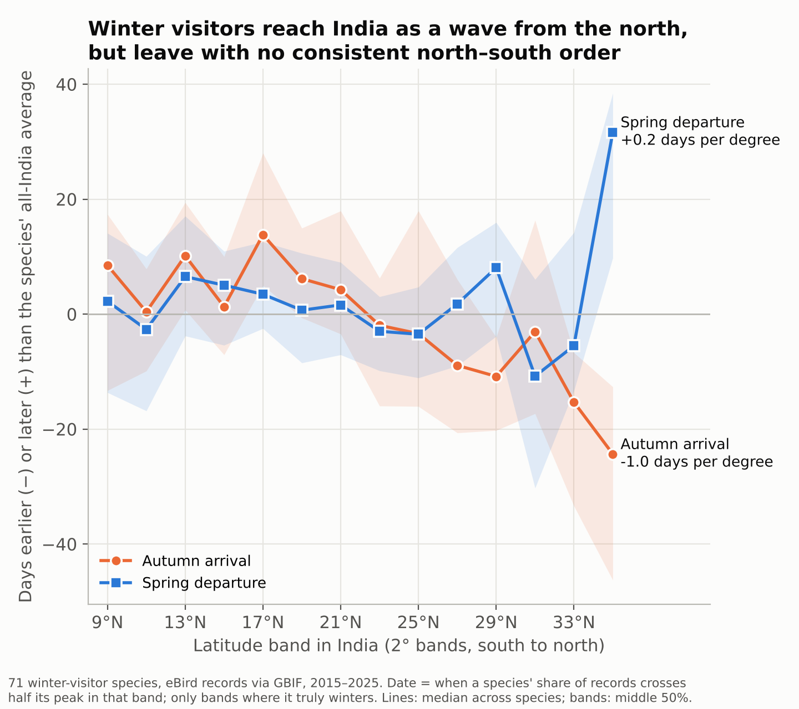

# Winter visitors to India: arrival and departure fronts by latitude

Do migratory birds that winter in India arrive and leave in a north-to-south order? Measured from ten years of eBird records (2015 to 2025) for 71 winter-visiting species across 14 latitude bands.

**Result.** Autumn arrival is an orderly wave from the north: northern India sees each species first, at roughly 1 to 1.5 days per degree of latitude, in 69 to 94% of species depending on the settings, significant in all 18 settings tested. Spring departure has no consistent order: the share of species that leave the south first ranges from 44 to 66% across settings and is significant only at the loosest threshold. Birds wintering in the far south do not leave clearly earlier than birds in the north, even though they have 2,000 km farther to fly.

All numbers come from the scripts in `src/` and can be rerun with one command.

## Data

GBIF, "EOD – eBird Observation Dataset" (CC BY 4.0), records in India, 2015 to 2025, counted by species, 2-degree latitude band (8°N to 36°N) and 10-day period. Pulled through the GBIF API on 2026-11-21; the pulled counts are saved in `data/` (about 10 MB). The dataset grows daily, so a fresh pull may give slightly different counts.

## Run it

```
./setup.sh      # installs packages, pulls counts from GBIF (about 5 minutes)
./run_all.sh    # about 3 minutes; writes results/ and figures/
```

Python 3.10 or later.

## Method

1. **Reporting rate.** For each species, band and 10-day period: species records divided by all eBird records in that band and period. Smoothed with a circular 3-point moving average.
2. **Winter visitors.** Species with at least 3,000 records in December to February whose June-July rate is below 3% of the winter rate: 78 species.
3. **Wintering bands.** For each species, only bands where the mid-winter rate is at least WINTER_MIN (default 0.5) of the band's peak, and with at least 60 winter records. This excludes bands the species only passes through.
4. **Dates.** Arrival = the day the smoothed rate first rises through THRESHOLD (default 0.5) of its peak, counting from 1 July; departure = the day it last falls through it. Interpolated between periods.
5. **Fronts.** Per species, arrival and departure dates regressed on latitude. Species with at least 4 bands spanning at least 8 degrees: 71 species. Slope in days per degree: negative arrival slope = north first; positive departure slope = south first.

## Results



Main setting (threshold 0.5, winter minimum 0.5, all years), `results/summary_main.json`:

| | Arrival (autumn) | Departure (spring) |
|---|---|---|
| Median slope, days per degree | −1.27 | +0.35 |
| Share of species in the north-first / south-first direction | 86% | 56% |
| Sign test p | 5e-10 | 0.34 |
| Median front speed (species with both fronts in the expected direction, n = 35) | 77 km/day | 89 km/day |

Robustness (`results/robustness.csv`), 18 settings = 3 thresholds × 2 winter minimums × {all years, 2015–2020, 2021–2025}:

- Arrival north-first: 67 to 94% of species, p ≤ 0.02 in every setting.
- Departure south-first: 44 to 66% of species. Significant (p < 0.05) only at threshold 0.25 for all years and for 2021–2025; not significant in the other 14 settings.
- Spring front faster than autumn front: true in most settings by the medians, but the Wilcoxon test on per-species slopes is significant in only some settings. Not claimed as a result.

Per-species slopes with names are in `results/fronts_main_named.csv`.

## Interpretation (not tested here)

If southern birds leave at about the same time as northern ones, they must travel faster or stop less on the way north. That fits the known finding that spring migration is more time-pressed than autumn migration. Sightings data cannot show individual journeys, so this is a hypothesis for tracking studies.

## Limits

- Citizen-science sightings, not tracked birds. "Arrival" and "departure" are reporting-rate crossings, which depend on the threshold.
- Reporting rate is the share of all records; it corrects for observer effort only roughly.
- Species are mixed: ducks, shorebirds, warblers, raptors. Some "winter visitors" may be mainly passage migrants in some bands despite the wintering-band filter.
- The 2-degree bands are large; the latitude boundaries are inclusive at both ends in the GBIF query, so a record lying exactly on a boundary is counted in two bands (negligible).
- Whether this comparison has been published before was not established.

## License

Code: MIT. Data: eBird via GBIF, CC BY 4.0; cite GBIF and the eBird Observation Dataset.
